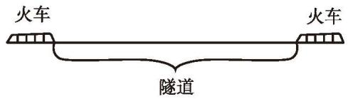
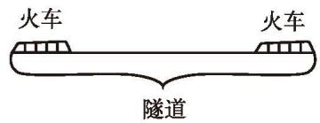

> [!success]- 例题解析
>
> > [!success] **【答案】** 详见解析
>
> > [!note]- **【分析】**
> > 这个问题涉及哪些量？你能画图说明“从车头进入隧道到车尾驶出隧道”的过程吗？这种情况下，火车行驶的路程与隧道的长度、火车的长度之间有什么关系？类似地，对于“火车全身都在隧道里”的情形，相信你也可以得到相应的关系！
>
> > [!note]- **【解析】**
> > 解：“从车头进入隧道到车尾驶出隧道”“火车全身都在隧道里”的过程可以分别用图 5-2、图 5-3 表示。
> >
> > 
> > 图5-2
> >
> > 
> > 图5-3
> >
> > 利用线段图梳理题目的关键信息，也是一种常用的方法。
> > 设隧道的长度为 $x \mathrm{~m}$ , 火车的长度为 $y \mathrm{~m}$ , 根据题意, 得
> >
> > $$
> > \left\{ \begin{array}{l} x + y = 40 \times 30, \\ x - y = 40 \times 20 _ {\circ} \end{array} \right.
> > $$
> >
> > 解这个方程组，得
> >
> > $$
> > \left\{ \begin{array}{l} x = 1000, \\ y = 200 _ {\circ} \end{array} \right.
> > $$
> >
> > 所以，隧道和火车的长度分别是 $1000 \, m$ 和 $200 \, m$ 。

对应题目：[Q070000002620](../Q070000002620.md)

> 来源：北师大版初中数学·八年级上册
