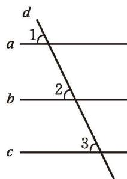

> [!success]- 例题解析
>
> > [!success] **【答案】** 详见解析
>
> > [!note]- **【分析】**
> > 由条件 $b \parallel a, c \parallel a$ 可以得到哪些等量关系？为了证明 $b \parallel c$ 需要怎样的等量关系？
>
> > [!note]- **【解析】**
> > 证明：∵ $b \parallel a$ （已知），
> > ∴ $\angle2=\angle1$ （两直线平行，同位角相等）。
> > $\because c \parallel a$ （已知），
> > ∴ $\angle3=\angle1$ （两直线平行，同位角相等）。
> > ∴ $\angle2=\angle3$ （等量代换）。
> > ∴ $b \parallel c$ (同位角相等，两直线平行)。
> >
> > 
> > 图7-12

对应题目：[Q070000002757](../Q070000002757.md)

> 来源：北师大版初中数学·八年级上册
