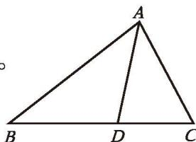

> [!success]- 北师大版初中数学·八年级下册
>
> > [!success] **【答案】** 详见解析
>
> > [!note]- **【解析】**
> > 解：在 $\triangle ABC$ 中, $\angle B + \angle C + \angle BAC = 180^{\circ}$ (三角形内角和定理)。 $\because \angle B = 38^{\circ}, \angle C = 62^{\circ}, \therefore \angle BAC = 180^{\circ} - 38^{\circ} - 62^{\circ} = 80^{\circ}$ 。 $\because AD$ 平分 $\angle BAC,$ $\therefore \angle BAD = \angle CAD = \frac{1}{2}\angle BAC = \frac{1}{2} \times 80^{\circ} = 40^{\circ}$ 。
> >
> > 
> > 图1-5
> >
> > 在 $\triangle ADB$ 中，
> > $\angle B + \angle BAD + \angle ADB = 180^{\circ}$ （三角形内角和定理）。 $\because \angle B = 38^{\circ}, \angle BAD = 40^{\circ},$ $\therefore \angle ADB = 180^{\circ} - 38^{\circ} - 40^{\circ} = 102^{\circ}$ 。
