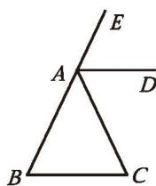

> [!success]- 北师大版初中数学·八年级下册
>
> > [!success] **【答案】** 详见解析
>
> > [!note]- **【分析】**
> > 只要具备什么条件，就能说明 $AD \parallel BC$ ？
> >
> > 
> >
> > [!note]- **【解析】**
> > 证明：∵ $\angle EAC = \angle B + \angle C$ （三角形的一个外角等于与它不相邻的两个内角的和），
> > 图1-7
> >
> > $$
> > \begin{array}{r l} & {\angle B = \angle C,} \\ {\therefore} & {\angle C = \frac {1}{2} \angle E A C _ {\circ}} \\ {\because} & {A D \text {平分} \angle E A C,} \\ {\therefore} & {\angle D A C = \frac {1}{2} \angle E A C _ {\circ}} \\ {\therefore} & {\angle D A C = \angle C _ {\circ}} \\ {\therefore} & {A D / / B C _ {\circ}} \end{array}
> > $$
> >
> > 还有其他证法吗？
