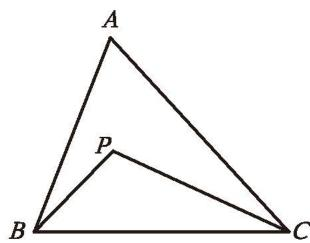
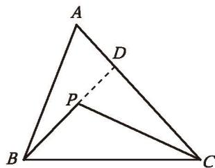

> [!success]- 例题解析
>
> > [!success] **【答案】** 详见解析
>
> > [!note]- **【分析】**
> > 你学过哪些关于角的不等关系的定理？这里能直接使用吗？你遇到的困难是什么？你能通过添加辅助线，构造出直接使用相关定理的图形吗？
> >
> > 
> > 图1-8
> >
>
> > [!note]- **【解析】**
> > 证明：如图 1-9，延长 BP，交 AC 于点 D。
> > $\because \angle BPC$ 是 $\triangle PDC$ 的一个外角（外角的定义），
> > ∴ $\angle BPC > \angle PDC$ (三角形的一个外角大于任何一个与它不相邻的内角)。
> >
> > 
> >
> > $\because \angle PDC$ 是 $\triangle ABD$ 的一个外角（外角的定义）， $\therefore \angle PDC > \angle A$ （三角形的一个外角大于任何
> > 图1-9
> > 一个与它不相邻的内角）。
> >
> > $$
> > \therefore \angle B P C > \angle A _ {\circ}
> > $$
> >
> > 

对应题目：[Q070000002782](../Q070000002782.md)

> 来源：北师大版初中数学·八年级下册
