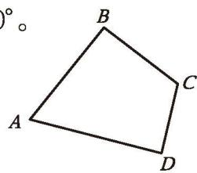

> [!success]- 例题解析
>
> > [!success] **【答案】** 详见解析
>
> > [!note]- **【解析】**
> > 解：∵ $\angle A + \angle B + \angle C + \angle D$ $=(4-2)\times180^{\circ}=360^{\circ}$ ,
> >
> > $$
> > \begin{array}{r l} {\therefore \quad \angle B + \angle D} \\ & {= 360 ^ {\circ} - (\angle A + \angle C)} \\ & {= 360 ^ {\circ} - 180 ^ {\circ}} \\ & {= 180 ^ {\circ}.} \end{array}
> > $$
> >
> > 
> > 图1-13
> >
> > 例 4 说明：如果四边形一组对角互补,那么另一组对角也互补。

对应题目：[Q070000002785](../Q070000002785.md)

> 来源：北师大版初中数学·八年级下册
