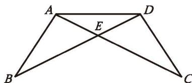

> [!success]- 北师大版初中数学·八年级下册
>
> > [!success] **【答案】** 详见解析
>
> > [!note]- **【解析】**
> > 证明：∵ AB = DC, BD = CA, AD = DA,
> > ∴ $\triangle ABD \cong \triangle DCA$ (SSS)。
> >
> > 
> > 图1-19
> >
> > ∴ $\angle ADB = \angle DAC$ (全等三角形的对应角相等)。
> > ∴ AE = DE (等角对等边)。
> > $\therefore \triangle AED$ 是等腰三角形。
