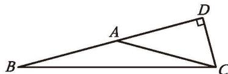

> [!success]- 北师大版初中数学·八年级下册
>
> > [!success] **【答案】** 详见解析
>
> > [!note]- **【解析】**
> > 证明：在 $\triangle ABC$ 中，
> >
> > 
> > 图1-23
> >
> > $$
> > \because A B = A C, \angle B = 15 ^ {\circ}
> > $$
> >
> > $\therefore \angle ACB = \angle B = 15^{\circ}$ (等边对等角)。
> > ∴ $\angle DAC = \angle B + \angle ACB = 15^{\circ} + 15^{\circ} = 30^{\circ}$ (三角形的一个外角等于与它不相邻的两个内角的和)。
> > ∵ CD 是腰 AB 上的高，
> >
> > $$
> > \therefore \angle A D C = 90 ^ {\circ}
> > $$
> >
> > ∴ $CD=\frac{1}{2}AC$ (在直角三角形中，如果一个锐角等于 $30^{\circ}$ ，那么它所对的直角边等于斜边的一半)。
> >
> > $$
> > \therefore C D = \frac {1}{2} A B _ {\circ}
> > $$
