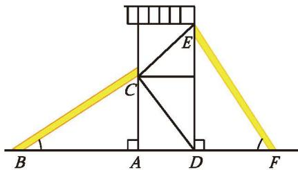

> [!success]- 例题解析
>
> > [!success] **【答案】** 详见解析
>
> > [!note]- **【解析】**
> > 解：根据题意，可知
> >
> > $$
> > \angle B A C = \angle E D F = 90 ^ {\circ},
> > $$
> >
> > $$
> > B C = E F, A C = D F,
> > $$
> >
> > $$
> > \therefore \quad \mathrm{Rt} \triangle B A C \cong \mathrm{Rt} \triangle E D F (\mathrm{HL}) _ {\circ}
> > $$
> >
> > 
> >
> > $\therefore \angle CBA = \angle FED$ (全等三角形的对
> > 图1-28
> > 应角相等）。
> > $\because \angle FED + \angle EFD = 90^{\circ}$ (直角三角形的两个锐角互余),
> >
> > $$
> > \therefore \angle C B A + \angle E F D = 90 ^ {\circ} 。
> > $$

对应题目：[Q070000002834](../Q070000002834.md)

> 来源：北师大版初中数学·八年级下册
