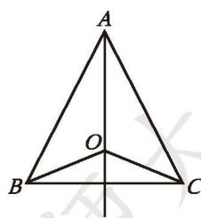

> [!success]- 例题解析
>
> > [!success] **【答案】** 详见解析
>
> > [!note]- **【解析】**
> > 证明：∵ AB = AC,
> > ∴ 点 A 在线段 BC 的垂直平分线上（到一条线段两个端）
> >
> > 
> > 图1-30
> >
> > 点距离相等的点，在这条线段的垂直平分线上）。
> > 同理，点 O 在线段 BC 的垂直平分线上。
> > ∴ 直线 AO 是线段 BC 的垂直平分线（两点确定一条直线）。
> > 还有其他证法吗？

对应题目：[Q070000002847](../Q070000002847.md)

> 来源：北师大版初中数学·八年级下册
