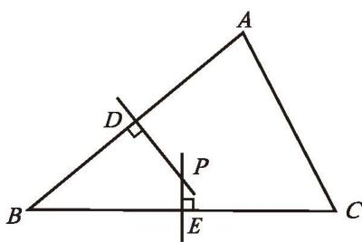
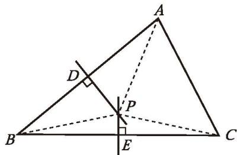

> [!success]- 例题解析
>
> > [!success] **【答案】** 详见解析
>
> > [!note]- **【分析】**
> > 要证明点 $P$ 在边 $AC$ 的垂直平分线上，需要什么条件？已知的两条垂直平分线相交于点 $P$ ，由此你能得到哪些相关的结论？
> >
> > 
> > 图1-33
> >
>
> > [!note]- **【解析】**
> > 证明：如图 1-34，连接 PA，PB，PC。
> > ∵ 点 P 在边 AB 的垂直平分线上，
> > ∴ PA = PB（线段垂直平分线上的点到这条线段两个端点的距离相等）。
> >
> > 
> > 图1-34
> >
> > 同理， $PB = PC$ 。
> >
> > $$
> > \therefore \quad P A = P B = P C _ {\circ}
> > $$
> >
> > ∴ 点 P 在线段 AC 的垂直平分线上（到一条线段两个端点距离相等的点，在这条线段的垂直平分线上），
> > 即 边 $AC$ 的垂直平分线经过点 $P$ 。

对应题目：[Q070000002850](../Q070000002850.md)

> 来源：北师大版初中数学·八年级下册
