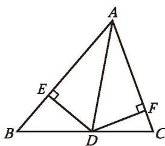

> [!success]- 北师大版初中数学·八年级下册
>
> > [!success] **【答案】** 详见解析
>
> > [!note]- **【解析】**
> > 解：∵ $DE \perp AB$ ， $DF \perp AC$ ，垂足分别为 E，F，且 DE = DF，
> >
> > 
> > 图1-37
> >
> > ∴ AD 平分 $\angle BAC$ （在一个角的内部，到角的两边距离相等的点在这个角的平分线上）。
> > 又∵ $\angle BAC=60^{\circ}$ ,
> >
> > $$
> > \therefore \angle B A D = 30 ^ {\circ} 。
> > $$
> >
> > 在 Rt△ADE 中，∠AED=90°，AD=10，
> > ∴ $DE=\frac{1}{2}AD=\frac{1}{2}\times10=5$ （在直角三角形中，如果一个锐角等于 $30^{\circ}$ ，那么它所对的直角边等于斜边的一半）。
