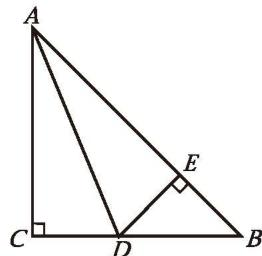

> [!success]- 北师大版初中数学·八年级下册
>
> > [!success] **【答案】** 详见解析
>
> > [!note]- **【解析】**
> > 解：$\because {AD}$ 是 $\bigtriangleup  {ABC}$ 的角平分线, ${DC}\bot {AC}$ , ${DE}\bot {AB}$ ,
> > $\therefore {DE} = {CD} = 4\mathrm{\;{cm}}$ (角平分线上的点到这个角的两边的距离相等)。
> >
> > $$
> > \because A C = B C,
> > $$
> >
> > $\therefore \angle B = \angle BAC$ （等边对等角）。 $\because \angle C = 90^{\circ}$ $\therefore \angle B = \frac{1}{2} \times 90^{\circ} = 45^{\circ}$ $\therefore \angle BDE = 90^{\circ} - 45^{\circ} = 45^{\circ}$ $\therefore BE = DE$ （等角对等边）。
> >
> > 
> > 图1-38
> >
> > 在等腰直角三角形 BDE 中，
> > $BD=\sqrt{DE^{2}+BE^{2}}=\sqrt{2DE^{2}}=4\sqrt{2}\ cm$ （勾股定理）。
> >
> > $$
> > \therefore A C = B C = C D + B D = (4 + 4 \sqrt {2}) \mathrm{cm} 。
> > $$
> >
> > (2) 证明: 由 (1) 的求解过程易知, Rt $\bigtriangleup  {ACD} \cong$ Rt $\bigtriangleup  {AED}$ (HL)。 ${AC} = {AE}$ (全等三角形的对应边相等)。 ${BE} = {DE} = {CD}$ , ${AB} = {AE} + {BE} = {AC} + {CD}$ 。
