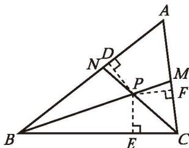

> [!success]- 例题解析
>
> > [!success] **【答案】** 详见解析
>
> > [!note]- **【分析】**
> > 要证明 $\angle A$ 的平分线经过点 $P$ ，需要什么条件？已知的两条角平分线相交于点 $P$ ，由此你能得到哪些相关的结论？
>
> > [!note]- **【解析】**
> > 证明：如图 1-40，过点 P 分别作 $PD \perp AB$ ， $PE \perp BC$ ， $PF \perp AC$ ，垂足分别为 D，E， $F_{0}$ 。
> > ∵ BM 是 $\triangle ABC$ 的角平分线，
> > ∴ PD = PE（角平分线上的点到这个角的两边的距离相等）。
> >
> > 
> >
> > 同理， $PE = PF$ 。
> > 图1-40
> >
> > $$
> > \therefore P D = P E = P F _ {\circ}
> > $$
> >
> > ∴ 点 P 在 $\angle A$ 的平分线上（在一个角的内部，到角的两边距离相等的点在这个角的平分线上），
> > 即 $\angle A$ 的平分线经过点 P。

对应题目：[Q070000002863](../Q070000002863.md)

> 来源：北师大版初中数学·八年级下册
