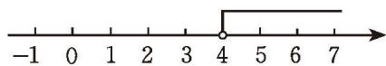
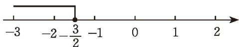

> [!success]- 北师大版初中数学·八年级下册
>
> > [!success] **【答案】** 详见解析
>
> > [!note]- **【解析】**
> > 解：(1) 根据不等式的基本性质 1, 两边都加 5, 得
> >
> > $$
> > x > - 1 + 5,
> > $$
> >
> > 即
> >
> > $$
> > x > 4 _ {\circ}
> > $$
> >
> > 这个不等式的解集在数轴上的表示如图 2-4 所示。
> >
> > 
> > 图2-4
> >
> > (2) 根据不等式的基本性质 3, 两边都除以 -2 , 得
> >
> > $$
> > x \leqslant - \frac {3}{2} \circ
> > $$
> >
> > 这个不等式的解集在数轴上的表示如图 2-5 所示。
> >
> > 
> > 图2-5
