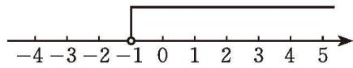

> [!success]- 北师大版初中数学·八年级下册
>
> > [!success] **【答案】** 详见解析
>
> > [!note]- **【解析】**
> > 解：两边都加 $-2x$ ，得
> >
> > $$
> > 3 - x - 2 x <   2 x + 6 - 2 x _ {\circ}
> > $$
> >
> > 合并同类项，得
> >
> > $$
> > 3 - 3 x <   6 _ {\circ}
> > $$
> >
> > 两边都加-3，得
> >
> > $$
> > 3 - 3 x - 3 <   6 - 3 _ {\circ}
> > $$
> >
> > 合并同类项，得解方程的移项变形对于解不等式同样适用。
> >
> > $$
> > - 3 x <   3 _ {\circ}
> > $$
> >
> > 两边都除以 -3，得
> >
> > $$
> > x > - 1 _ {\circ}
> > $$
> >
> > 这个不等式的解集在数轴上的表示如图 2-6 所示。
> >
> > 
> > 图2-6
