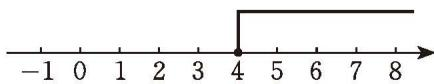

> [!success]- 北师大版初中数学·八年级下册
>
> > [!success] **【答案】** 详见解析
>
> > [!note]- **【解析】**
> > 解：去分母，得
> >
> > $$
> > 3 (x - 2) \geqslant 2 (7 - x) _ {\circ}
> > $$
> >
> > 去括号，得
> >
> > $$
> > 3 x - 6 \geqslant 14 - 2 x _ {\circ}
> > $$
> >
> > 移项、合并同类项，得
> >
> > $$
> > 5 x \geqslant 20 _ {\circ}
> > $$
> >
> > 两边都除以 5，得
> >
> > $$
> > x \geqslant 4 _ {\circ}
> > $$
> >
> > 这个不等式的解集在数轴上的表示如图 2-7 所示。
> >
> > 
> > 图2-7
