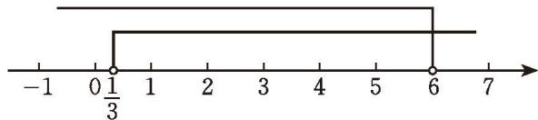

> [!success]- 例题解析
>
> > [!success] **【答案】** 详见解析
>
> > [!note]- **【解析】**
> > 解：解不等式 ①，得
> >
> > $$
> > x > \frac {1}{3} \circ
> > $$
> >
> > 解不等式 ②，得
> >
> > $$
> > x <   6 _ {\circ}
> > $$
> >
> > 在同一条数轴上表示不等式 ①②的解集，如图2-9所示。
> >
> > 
> > 图2-9
> >
> > 因此，原不等式组的解集是
> >
> > $$
> > \frac {1}{3} <   x <   6 _ {\circ}
> > $$

对应题目：[Q070000002943](../Q070000002943.md)

> 来源：北师大版初中数学·八年级下册
