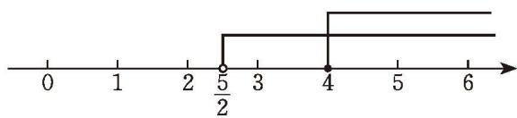

> [!success]- 北师大版初中数学·八年级下册
>
> > [!success] **【答案】** 详见解析
>
> > [!note]- **【解析】**
> > 解：解不等式 ①，得
> >
> > $$
> > x > \frac {5}{2} \circ
> > $$
> >
> > 解不等式 ②，得
> >
> > $$
> > x \geqslant 4 _ {\circ}
> > $$
> >
> > 在同一条数轴上表示不等式 ① ② 的解集，如图 2-10 所示。
> >
> > 
> > 图2-10
> >
> > 因此，原不等式组的解集是
> >
> > $$
> > x \geqslant 4 _ {\circ}
> > $$
