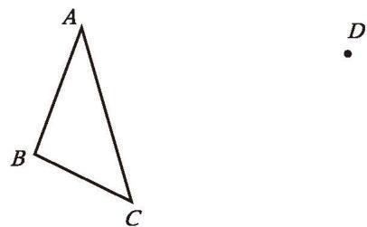
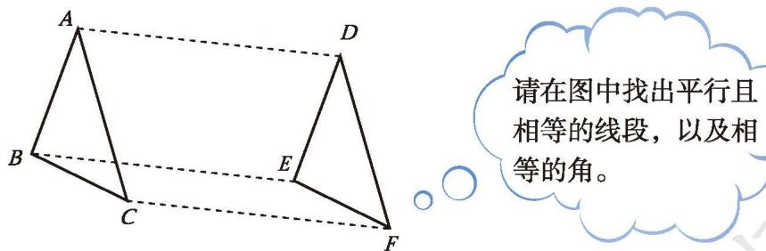

> [!success]- 北师大版初中数学·八年级下册
>
> > [!success] **【答案】** 详见解析
>
> > [!note]- **【解析】**
> > 解：（1）如图 3-6，连接 AD，平移的方向是点 A 到点 D 的方向，平移的距离是线段 AD 的长度。
> >
> > 
> >
> > (2) 如图 3-6, 分别过点 $B$ , $C$ 按射线 $AD$ 的方向作线段 $BE$ , $CF$ , 使它们与线段 $AD$ 平行
> > 图3-5
> > 且相等，连接 $DE, DF, EF$ ， $\triangle DEF$ 就是 $\triangle ABC$ 平移后的图形。
> >
> > 
> > 图3-6
> >
> > 请在图中找出平行且相等的线段，以及相等的角。
> > 对于例 1，你还有画 $\triangle DEF$ 的其他方法吗？
