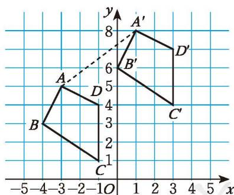

> [!success]- 北师大版初中数学·八年级下册
>
> > [!success] **【答案】** 详见解析
>
> > [!note]- **【解析】**
> > 解：(1) 四边形 $A'B'C'D'$ 与四边形 $ABCD$ 相了 4, 纵坐标分别增加了 3; $A'(1,8), B'(0,6), C'(3,4), D'(3,7)$ 。
> >
> > （2）如图 3-10，连接 $AA'$ ，由图可知， $AA' = \sqrt{4^2 + 3^2} = 5$ 。因此，如果将四边形 $A'B'C'D'$ 看成是由四边形 $ABCD$ 经过一次平移得到的，那么这一平移的平移方向是由 $A$ 到 $A'$ 的方向，平移距离是 5 个单位长度。
> >
> > 
> > 图3-10
