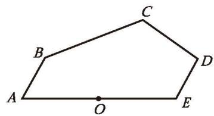
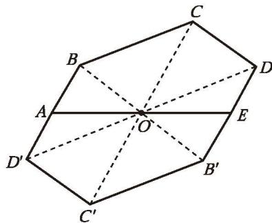

> [!success]- 例题解析
>
> > [!success] **【答案】** 详见解析
>
> > [!note]- **【解析】**
> > 解：如图 3-24，连接 BO 并延长至 $B'$ ，使 $OB' = OB$ ;
> >
> > 
> > 图3-23
> >
> > 连接 ${CO}$ 并延长至 ${C}^{\prime }$ ,使 $O{C}^{\prime } = {OC}$ ；
> > 连接 DO 并延长至 $D'$ ，使 $OD' = OD$ ;
> > 顺次连接 $E, B', C', D', A$ 。
> > 图形 $EB'C'D'A$ 就是以点 $O$ 为对称中心、与五边形 $ABCDE$ 成中心对称的图形。
> >
> > 
> > 图3-24

对应题目：[Q070000002997](../Q070000002997.md)

> 来源：北师大版初中数学·八年级下册
