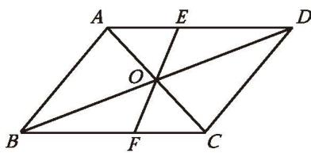

> [!success]- 例题解析
>
> > [!success] **【答案】** 详见解析
>
> > [!note]- **【解析】**
> > 证明：∵ 四边形 ABCD 是平行四边形，
> > ∴ DO=BO（平行四边形的对角线互相平分），
> > AD∥BC（平行四边形的定义）。
> > ∴ $\angle ODE = \angle OBF$ 。
> > ∵ $\angle DOE = \angle BOF$ ,
> > ∴ $\triangle DOE \cong \triangle BOF$ 。
> > ∴ OE = OF。
> >
> > 
> > 图6-6

对应题目：[Q070000003172](../Q070000003172.md)

> 来源：北师大版初中数学·八年级下册
