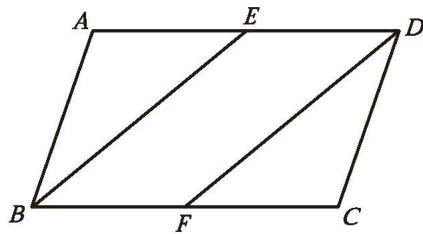

> [!success]- 例题解析
>
> > [!success] **【答案】** 详见解析
>
> > [!note]- **【解析】**
> > 证明：∵ 四边形 ABCD 是平行四边形，
> >
> > 
> >
> > ∴ AD = CB（平行四边形的对边相等）， $AD \parallel CB$ （平行四边形的定义）。
> > 图 6-11
> > ∵ E, F 分别为 AD 和 CB 的中点，
> >
> > $$
> > \therefore E D = \frac {1}{2} A D, F B = \frac {1}{2} C B _ {\circ}
> > $$
> >
> > $$
> > \therefore \quad E D = F B, E D / / F B _ {\circ}
> > $$
> >
> > ∴ 四边形 BFDE 是平行四边形（一组对边平行且相等的四边形是平行四边形）。

对应题目：[Q070000003183](../Q070000003183.md)

> 来源：北师大版初中数学·八年级下册
