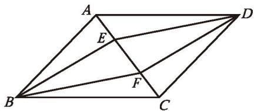
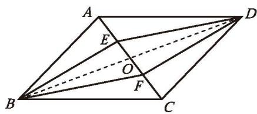

> [!success]- 北师大版初中数学·八年级下册
>
> > [!success] **【答案】** 详见解析
>
> > [!note]- **【分析】**
> > 要证明一个四边形是平行四边形，如果从对角线的角度考虑，需要满足什么条件？如果从对边的角度考虑呢？
> >
> > 
> > (1)
> >
> > 
> > 图6-13
> >
> > (2)
>
> > [!note]- **【解析】**
> > 证明：如图 6-13（2），连接 BD，交 AC 于点 O。
> > ∵ 四边形 ABCD 是平行四边形，
> > $\therefore {OA} = {OC},{OB} = {OD}$ (平行四边形的对角线互相平分)。
> >
> > $$
> > \because A E = C F,
> > $$
> >
> > $$
> > \therefore O A - A E = O C - C F,
> > $$
> >
> > 即 $OE = OF$ 。
> > ∴ 四边形 BFDE 是平行四边形（对角线互相平分的四边形是平行四边形）。
> > 还有其他证法吗？
