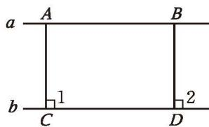

> [!success]- 北师大版初中数学·八年级下册
>
> > [!success] **【答案】** 详见解析
>
> > [!note]- **【解析】**
> > 证明：∵ $AC \perp CD, BD \perp CD,$
> >
> > $$
> > \therefore \angle 1 = \angle 2 = 90 ^ {\circ} 。
> > $$
> >
> > 
> >
> > $$
> > \therefore A C \parallel B D _ {\circ}
> > $$
> >
> > 图6-15
> >
> > $$
> > \because A B \parallel C D,
> > $$
> >
> > ∴ 四边形 ACDB 是平行四边形（平行四边形的定义）。
> > $\therefore AC=BD$ (平行四边形的对边相等)。
