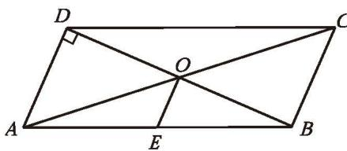

> [!success]- 例题解析
>
> > [!success] **【答案】** 详见解析
>
> > [!note]- **【解析】**
> > 解：∵ □ABCD 的对角线 AC 与 BD 相交于点 O,
> >
> > 
> > 图6-21
> >
> > ∴ OA = OC, OD = OB (平行四边形的对角线互相平分)。
> > ∵ E 为 AB 的中点，
> > $\therefore {OE}$ 是 $\bigtriangleup  {ADB}$ 的中位线(三角形的中位线的定义)。
> > $\therefore AD=2OE=2$ （三角形的中位线定理）。
> >
> > $$
> > \because A C = 6, O A = O C,
> > $$
> >
> > $$
> > \therefore O A = \frac {1}{2} A C = \frac {1}{2} \times 6 = 3 。
> > $$
> >
> > 在 Rt△ADO 中，由勾股定理可得
> >
> > $$
> > O D = \sqrt {O A ^ {2} - A D ^ {2}} = \sqrt {3 ^ {2} - 2 ^ {2}} = \sqrt {5} 。
> > $$
> >
> > $$
> > \therefore B D = 2 O D = 2 \sqrt {5} 。
> > $$

对应题目：[Q070000003206](../Q070000003206.md)

> 来源：北师大版初中数学·八年级下册
