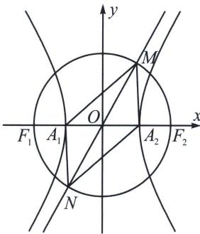

> [!faq]- 2026版高中《mst老唐说题》圆锥曲线专题（数学）
> 解析 设斜率为正的渐近线 $l_{MN}$ ： $y=\frac{b}{a}x$ ，又MO=r=c，则易知 $M(a,b)$ ，又 $A_{1}(-a,0)$ ， $A_{2}(a,0)$ 则 $MA_{2}\perp A_{1}A_{2}$ ，如图：
>
> 
>
> $\angle A_{1}MA_{2}=\pi-\angle NA_{1}M=\frac{\pi}{6},\quad A$ 正确；
>
> 则在 $\mathrm{Rt}\Delta A_1MA_2$ 中， $\angle MA_{1}A_{2} = 60^{\circ}$ ，故 $\sqrt{3}|MA_1| = 2|MA_2|$ ，B错误；
>
> 因为 $\tan \angle A_{1}MA_{2} = \frac{2a}{b} = \frac{\sqrt{3}}{3}$ ，则 $e = \frac{c}{a} = \sqrt{1 + \frac{b^2}{a^2}} = \sqrt{13}$ ，C正确；
>
> 当 $a = \sqrt{2}$ 时， $S_{NA_1MA_2} = 2 \times \frac{1}{2} |MA_1| \cdot |MA_2| = 2ab = 8\sqrt{3}$ ，D正确，故本题选ACD.
