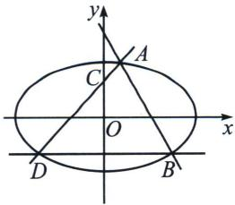
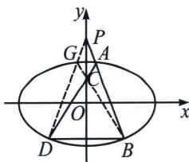

> [!faq]- 2026版高中《mst老唐说题》圆锥曲线专题（数学）
>
> > [!success]- **【答案】** A
>
> > [!note]- **【解析】**
> > 解析 (1)椭圆方程 $C: \frac{x^2}{a^2} + \frac{y^2}{b^2} = 1 (a > b > 0)$ , 焦点和短轴端点构成边长为 2 的正方形, 则 $b = c = \frac{2}{\sqrt{2}} = \sqrt{2}$ , 故 $a^2 = b^2 + c^2 = 2$ , 解得 $a = \sqrt{2}$ ; $a = \sqrt{b^2 + c^2} = 2$ , 所以椭圆方程为 $\frac{x^2}{4} + \frac{y^2}{2} = 1$ , 离心率为 $e = \frac{\sqrt{2}}{2}$ ;
> >
> > (2)
> > 解法一：设 $A(x_{1},y_{1})$ ， $B(x_{2},y_{2})$ ， $D(-x_ {2},y_{2})$ ， $P(0,t)$
> >
> > 
> >
> > 
> >
> > 由 A、C、D 三点共线可得： $\frac{y_{1}-1}{x_{1}}=\frac{y_{2}-1}{-x_{2}}\Rightarrow x_{1}y_{2}+x_{2}y_{1}=x_{2}+x_{1}①$
> >
> > 且 $y_{1}^{2}=2-\frac{x_{1}^{2}}{2}$ ， $y_{2}^{2}=2-\frac{x_{2}^{2}}{2}$ ②，又 $(x_{1}y_{2}-x_{2}y_{1})(x_{1}y_{2}+x_{2}y_{1})=x_{1}^{2}y_{2}^{2}-x_{2}^{2}y_{1}^{2}$ ，所以 $y_{1}x_{2}-y_{2}x_{1}=2(x_{1}-x_{2})$ 由 A、B、P 三点共线有： $\frac{y_{1}-t}{x_{1}}=\frac{y_{2}-t}{x_{2}}\rightarrow y_{1}x_{2}-y_{2}x_{1}=t(x_{1}-x_{2})$ ，所以 t=2.
> >
> > 解法二(齐次化): 将椭圆按照 $\overrightarrow{CO}$ 方向平移得椭圆 $E'$ , 则 $C \to O$ , $A \to A'$ , $B \to B'$ , $D \to D'$ 椭圆 $E'$ : $\frac{(y+1)^2}{2} + \frac{x^2}{4} = 1$ , 设直线 $l_{A'B'}: mx + ny = 1$ , 椭圆 $E': x^2 + 2y^2 + 4y - 2 = 0$ ,
> >
> > 联立得： $x^{2}+4y(mx+ny)+2y^{2}-2(mx+ny)^{2}=0$ ，两边同除以 $x^{2}$ ， $(2+4n-2n^{2})\frac{y^{2}}{x^{2}}+(4m-4mn)\frac{y}{x}-2m^{2}+1=0$ ， $k_{CD}+k_{CB}=-\frac{4m-4mn}{2+4n-2n^{2}}=0$ ，所以4m-4mn=4m(1-n)=0，故n=1， $A^{\prime}B^{\prime}$ 过定点 $P^{\prime}(0,1)$ ，则 $P(0,2)$ ，所以t=2。
