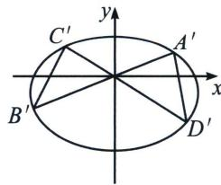

> [!faq]- 2026版高中《mst老唐说题》圆锥曲线专题（数学）
>
> > [!success]- **【答案】** 详见解析
>
> > [!note]- **【解析】**
> > 解析 (1) $\frac{x^2}{8} + \frac{y^2}{4} = 1$
> >
> > 
> >
> > (2)将椭圆按(0, -1)平移得： $\frac{x^{2}}{8}+\frac{y^{2}}{4}+\frac{y}{2}-\frac{3}{4}=0$
> >
> > $$
> > A ^ {\prime} B ^ {\prime}: y = k _ {1} x, C ^ {\prime} D ^ {\prime}: y = k _ {2} x, A ^ {\prime} D ^ {\prime}: x = t _ {1} y + m _ {1}, B ^ {\prime} C ^ {\prime}: x = t _ {2} y + m _ {2},
> > $$
> >
> > 所以 $(k_{1}x - y)(k_{2}x - y) + \lambda (x - t_{1}y - m_{1})(x - t_{2}y - m_{2}) = \mu \left(\frac{x^{2}}{8} +\frac{y^{2}}{4} +\frac{y}{2} -\frac{3}{4}\right)$
> >
> > 所以 $x$ 系数： $\lambda (-m_1 - m_2) = 0$ ，所以 $m_{1} + m_{2} = 0$
