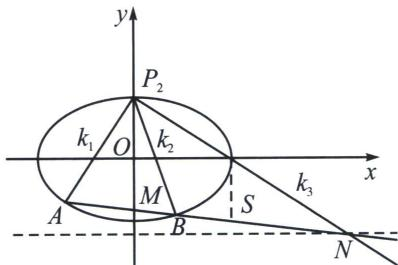
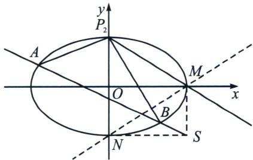

> [!faq]- 《圆锥曲线专题(下册)》例题解析
>
> > [!success]- **【答案】** 详见解析
>
> > [!note]- **【解析】**
> > 方案一(调和线束斜率公式解读): 由于 $k_{P_2A} + k_{P_2B} = k_1 + k_2 = -1$ , 故需要构造 $k_1 + k_2 = 2k_3 = -1$ , 故 $k_3 = -\frac{1}{2}$ , 设 $AB$ 与 $y$ 轴交点为 $M(0, n)$ , 找到 $M$ 对应的极线 $y = \frac{1}{n}$ , 延长 $AB$ 交极线于 $N$ , 易知 $P_2(AB, MN) = -1 \Rightarrow k_{P_2N} = k_3 = -\frac{1}{2}$ ,
> > 
> > 所以 $P_{2}N: y = -\frac{1}{2}x + 1$ ，所以 $N\left(2 - \frac{2}{n}, \frac{1}{n}\right)$ ，故 MN 的直线方程为 $y = -\frac{n+1}{2}x + n$ ，故 AB 过定点 $S(2, -1)$ .
> > 方案二(对合中心分析): 过 $P_{2}$ 延 $y$ 轴 (斜率不存在) 交椭圆于对合不动点 $N(0, -1)$ , 过 $P_{2}$ 作斜率为 $-\frac{1}{2}$ 直线, 即 $y = -\frac{1}{2} x + 1$ 交椭圆于另一个不动点 $M(2, 0)$ , 此时 $MN$ 即为满足 $k_{P_{2} A} + k_{P_{2} B} = k_{1} + k_{2} = -1$ 的对合轴, 根据极点极线极配可知, 对合中心为两对合不动点切线的交点 $S(2, -1)$ , 对合轴 $MN$ 方程为 $y = \frac{x}{2} - 1$ .
> > 
> > 注意 显然寻找对合轴和对合中心的方法相比利用极点极线的斜率公式构造调和点列，更容易找到定点定值.

对应题目：[Q070000003740](../Q070000003740.md)

> 来源：2026版高中《mst老唐说题》圆锥曲线专题（数学）
