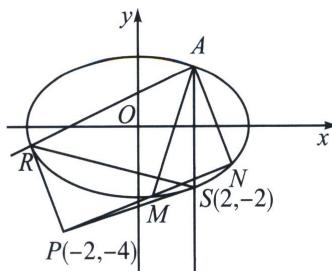

> [!faq]- 2026版高中《mst老唐说题》圆锥曲线专题（数学）
>
> > [!success]- **【答案】** 详见解析
>
> > [!note]- **【分析】**
> > 过 A 作 AS // y 轴交椭圆于 S(2, -2)，过 A 作斜率为 $\frac{1}{2}$ 直线，即 $y = \frac{1}{2}x + 1$ 交椭圆于 $R\left(-\frac{10}{3}, -\frac{2}{3}\right)$ ，和 S 均为不动点，点 S 处切线方程为 $\frac{2x}{12} + \frac{-2y}{6} = 1$ ，点 R 处切线方程为 $\frac{-\frac{10}{3}x}{12} + \frac{-\frac{2}{3}y}{6} = 1$ ，根据极点极线极配可知，联立 $\left\{\begin{aligned}\frac{2x_{P}}{12} + \frac{-2y_{P}}{6 &= 1 \\-\frac{10}{3}x_{P} &+\frac{-\frac{2}{3}y_{P}}{6} = 1\end{aligned}\right.$ 故对合中心为 P(-2, -4)，对合轴 RS 方程为 $y = -\frac{x}{4} - \frac{3}{2}$ .
>
> > [!note]- **【解析】**
> > 
