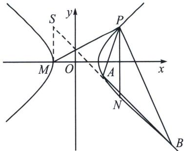
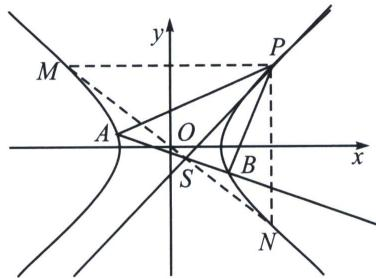

> [!faq]- 《圆锥曲线专题(下册)》例题解析
>
> > [!success]- **【答案】** 详见解析
>
> > [!note]- **【分析】**
> > 选①. 过 $P$ 作斜率为 $\frac{1}{2}$ 的直线交双曲线于第一个对合不动点 $M(-2,0)$ , 再过 $P$ 作 $y$ 轴平行线交双曲线于另一个对合不动点 $N(4,-3)$ , 分别作出两切线 $\left\{\begin{array}{l} x=-2 \\ \frac{4x}{4}-\frac{-3y}{3}=1 \end{array}\right.$ , 它们交点就是对合中心 $S(-2,3)$ .
>
> > [!note]- **【解析】**
> > 
> > 选②. 作点 $P$ 处切线 $l: \frac{4x}{4} - \frac{3y}{3} = 1$ , 即 $y = x - 1$ , 此时切线斜率为 1, 则 $P$ 与 $A$ 和 $B$ 均重合, 再过 $P$ 作 $x$ 轴平行线和 $y$ 轴平行线分别交于 $M(-4, 3)$ 和 $N(4, -3)$ , 此时 $MN: y = -\frac{3}{4}x$ , 点 $P$ 处的切线 $y = x - 1$ , 联立 $\left\{ \begin{array}{l} y = x - 1 \\ y = -\frac{3}{4}x \end{array} \right.$ , 可得对合中心为 $S\left(\frac{4}{7}, -\frac{3}{7}\right)$ .
> > 
> > 注意 当射影中心 $P$ 已知的情况下，齐次化这种斜率对合方程永远是最好的解答方法.

对应题目：[Q070000003743](../Q070000003743.md)

> 来源：2026版高中《mst老唐说题》圆锥曲线专题（数学）
