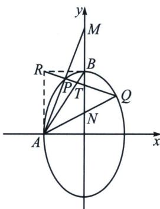

> [!faq]- 《圆锥曲线专题(下册)》例题解析
>
> > [!success]- **【答案】** 详见解析
>
> > [!note]- **【解析】**
> > 解析 (1)椭圆 C 的方程为 $\frac{y^{2}}{9} + \frac{x^{2}}{4} = 1$ ;
> >
> > 
> >
> > 如图，由 $R(-2,3)$ 为对合中心作椭圆两条切线，分别切于左顶点 A 和上顶点 B，AB 为对合轴，分别记则 AP、AQ、AB 斜率为 $k_{1}$ 、 $k_{2}$ 、 $k_{3}$ ，由于 $AR \parallel y$ 轴，所以 $k_{1} + k_{2} = 2k_{3} = 3$ ，再分析与 y 轴平行的 $\triangle AMN$ ，且 $k_{AM} + k_{AN} = 2k_{AB}$ ，可知 BM = BN。

对应题目：[Q070000003724](../Q070000003724.md)

> 来源：2026版高中《mst老唐说题》圆锥曲线专题（数学）
