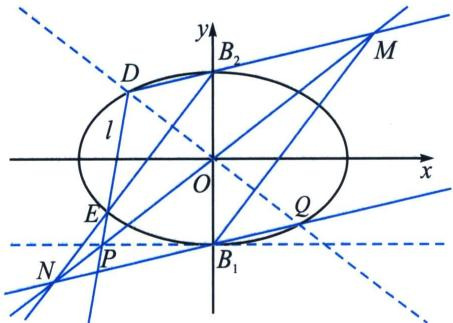
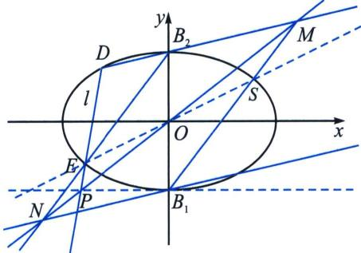

> [!faq]- 《圆锥曲线专题(下册)》例题解析
>
> > [!success]- **【答案】** 详见解析
>
> > [!note]- **【分析】**
> > 如左图延长 $B_{1}N$ 交椭圆于 $Q$ ，我们需要证 $D$ 、 $Q$ 关于原点对称，构造内接六边形 $B_{1}B_{1}B_{2}EDQ$ ， $B_{1}B_{1}$ 与 $ED$ 交于 $P$ ， $B_{1}B_{2}$ 与 $DQ$ 交于 $O'$ ， $B_{2}E$ 与 $B_{1}Q$ 交于 $N$ ，根据帕斯卡定理，则 $P$ ， $N$ ， $O'$ 三点共线，由于 $O'$ 在 $B_{1}B_{2}$ 上，故 $O'$ 与 $O$ 重合。故 $D$ 、 $Q$ 关于原点对称，所以 $B_{1}N//B_{2}M$ .
>
> > [!note]- **【解析】**
> > 
> > 
> > 如右图，设 $B_{1}M$ 交椭圆于 $S$ ，我们需要证 $E$ 、 $S$ 关于原点对称，构造内接六边形 $B_{1}B_{1}B_{2}DES$
> > $B_{1}B_{1}$ 与 DE 交于 P， $B_{1}B_{2}$ 与 ES 交于 $O'$ ， $B_{2}D$ 与 $B_{1}S$ 交于 M，根据帕斯卡定理，则 P，M， $O'$ 三点共线，由于 $O'$ 在 $B_{1}B_{2}$ 上，故 $O'$ 与 O 重合。故 E、S 关于原点对称，所以 $B_{1}M \parallel B_{2}N$ 。
> > 所以四边形 $B_{1}MB_{2}N$ 为平行四边形.

对应题目：[Q070000003776](../Q070000003776.md)

> 来源：2026版高中《mst老唐说题》圆锥曲线专题（数学）
