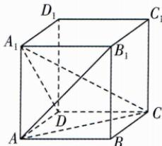

> [!faq]- 必刷题解析
> **【答案】** AB
>
> **【解析】**
> 对 A, 由图可知, $\overrightarrow{A_{1}B_{1}}\cdot\overrightarrow{AC}=\overrightarrow{AB}\cdot\overrightarrow{AC}=\sqrt{2}\times1\times\frac{\sqrt{2}}{2}=1$ , A 正确;
对 B, $\overrightarrow{AB} \cdot \overrightarrow{A_{1}C} = \overrightarrow{AB} \cdot (\overrightarrow{A_{1}A} + \overrightarrow{AC}) = \overrightarrow{AB} \cdot \overrightarrow{A_{1}A} + \overrightarrow{AB} \cdot \overrightarrow{AC} = \overrightarrow{AB} \cdot \overrightarrow{AC} = 1$ , B 正确;
对 C, $\overrightarrow{CD} \cdot \overrightarrow{AB_{1}} = \overrightarrow{CD} \cdot (\overrightarrow{AB} + \overrightarrow{BB_{1}}) =$ $\overrightarrow{CD}\cdot\overrightarrow{AB}+\overrightarrow{CD}\cdot\overrightarrow{BB_{1}}=-1,C$ 错误；
对 D, 因为 $AB \perp$ 侧面 $ADD_{1}A_{1}, A_{1}D \subset$ 平面 $ADD_{1}A_{1}$ ，所以 $AB \perp A_{1}D$ ，即 $\overrightarrow{AB} \cdot \overrightarrow{A_{1}D}=0, D$ 错误. 故选 AB.

对应题目：[Q070000003858](../Q070000003858.md)

> 来源：2026版 必刷题 数学选择性必修第一册RJA
