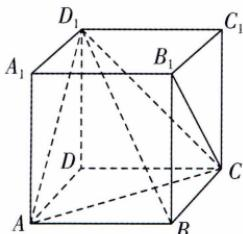

> [!faq]- 必刷题解析
> **【答案】** C
>
> **【解析】**
> 当长方体 $ABCD - A_1B_1C_1D_1$ 为正方体时，根据正方体的性质可知， $\overrightarrow{AB} \perp \overrightarrow{AD_1}$ ， $\overrightarrow{AD_1} \perp \overrightarrow{B_1C}, \overrightarrow{BD_1} \perp \overrightarrow{AC}$ ，所以 $\overrightarrow{AB} \cdot \overrightarrow{AD_1} = 0$ ， $\overrightarrow{AD_1} \cdot \overrightarrow{B_1C} = 0, \overrightarrow{BD_1} \cdot \overrightarrow{AC} = 0.$ 根据长方体的性质可知 $BC \perp CD_1$ ，所以 $BD_1$ 与 $BC$ 不垂直，即 $\overrightarrow{BD_1} \cdot \overrightarrow{BC}$ 一定不为 0. 故选 C.

对应题目：[Q070000003865](../Q070000003865.md)

> 来源：2026版 必刷题 数学选择性必修第一册RJA
