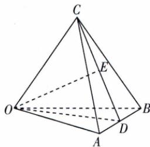

> [!faq]- 必刷题解析
> **【解析】**
> （1）【解】连接 $OD$ ，如图所示，则 $\overrightarrow{OE} = \frac{1}{2}\overrightarrow{OC} +\frac{1}{2}\overrightarrow{OD} = \frac{1}{2}\overrightarrow{OC} +\frac{1}{2}\times$ $\frac{1}{2}\times (\overrightarrow{OA} +\overrightarrow{OB}) = \frac{1}{4}\overrightarrow{OA} +\frac{1}{4}\overrightarrow{OB}+$ $\frac{1}{2}\overrightarrow{OC} = \frac{1}{4}\pmb {a} + \frac{1}{4}\pmb {b} + \frac{1}{2}\pmb {c}.$

(2)【证明】 $\overrightarrow{AB}=\overrightarrow{OB}-\overrightarrow{OA}=b-a,$ 所以 $\overrightarrow{OE}\cdot\overrightarrow{AB}=\left(\frac{1}{4}a+\frac{1}{4}b+\frac{1}{2}c\right)\cdot(b-a)$ $=\frac{1}{4}a\cdot b+\frac{1}{4}b^{2}+\frac{1}{2}b\cdot c-\frac{1}{4}a^{2}-\frac{1}{4}a\cdot b-\frac{1}{2}a\cdot c$ $=\frac{1}{4}b^{2}+\frac{1}{2}b\cdot c-\frac{1}{4}a^{2}-\frac{1}{2}a\cdot c$ $=\frac{1}{4}+\frac{1}{2}\times\cos\frac{\pi}{3}-\frac{1}{4}-\frac{1}{2}\times\cos\frac{\pi}{3}=0,$ 所以 $OE \perp AB.$

对应题目：[Q070000003867](../Q070000003867.md)

> 来源：2026版 必刷题 数学选择性必修第一册RJA
