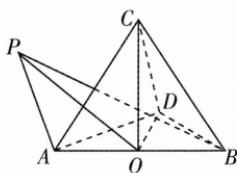

> [!faq]- 必刷题解析
> **【答案】** BC
>
> **【解析】**
> 如图, 设 AB 的中点为 O, 连接 PO, 则 $\overrightarrow{PO} = \frac{1}{2} \overrightarrow{PA} + \frac{1}{2} \overrightarrow{PB}$ , 即 $2 |\overrightarrow{PO}| = |\overrightarrow{PA} + \overrightarrow{PB}|$ .
又 $|\overrightarrow{PB}+\overrightarrow{PA}|=2$ ，所以 $|\overrightarrow{PO}|=1$ ，
即点 P 在以 O 为球心，以 1 为半径的球面上.

因为 $\overrightarrow{AP} = \overrightarrow{AO} +\overrightarrow{OP}$ ，所以 $\overrightarrow{AP}\cdot \overrightarrow{AD}$ $= (\overrightarrow{AO} +\overrightarrow{OP})\cdot \overrightarrow{AD} = \overrightarrow{AO}\cdot \overrightarrow{AD} +\overrightarrow{OP}\cdot \overrightarrow{AD}.$ 由正四面体ABCD的棱长为 $2\sqrt{2}$ ，得 $AO = \sqrt{2}$ 所以 $\overrightarrow{AO}\cdot \overrightarrow{AD} = |\overrightarrow{AO} ||\overrightarrow{AD} |\cos 60^{\circ} =$

## 刷基础

对应题目：[Q070000003882](../Q070000003882.md)

> 来源：2026版 必刷题 数学选择性必修第一册RJA
