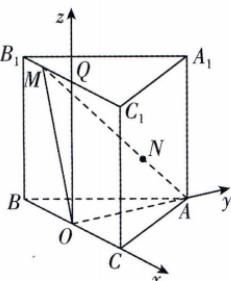

> [!faq]- 2026版 必刷题 数学选择性必修第一册RJA
> **【答案】** D
>
> **【解析】**
> 因为正三棱柱 ABC - $A_{1}B_{1}C_{1}$ 中， $\overrightarrow{BC}=2\overrightarrow{BO}$ ，所以 O 为 BC 的中点，取 $B_{1}C_{1}$ 的中点 Q，连接 OQ，OA，如图，以 O 为原点，OC，OA，OQ 所在直线分别为 x, y, z 轴建立如图所示的空间直角坐标系，
> 
> 则 $O(0,0,0), A(0,\sqrt{3},0), B_1(-1,0,\sqrt{3}), C_1(1,0,\sqrt{3})$ ，因为 $M$ 是棱 $B_1C_1$ 上的动点，设 $M(a,0,\sqrt{3})$ ，且 $a \in [-1,1]$ ，因为 $\overrightarrow{MA} = (-a,\sqrt{3}, -\sqrt{3})$ ，且 $\frac{MN}{MO} = \frac{MO}{MA}$ ，所以 $MN = \frac{MO^2}{MA} =$ $\frac{a^2 + 3}{\sqrt{(-a)^2 + (\sqrt{3})^2 + (-\sqrt{3})^2}} = \frac{a^2 + 3}{\sqrt{a^2 + 6}}$ 令 $t = \sqrt{a^2 + 6}, t \in [\sqrt{6}, \sqrt{7}]$ ，所以 $\frac{a^2 + 3}{\sqrt{a^2 + 6}} = \frac{t^2 - 3}{t} = t - \frac{3}{t}, t \in [\sqrt{6}, \sqrt{7}]$ ，又函数 $y = t - \frac{3}{t}$ 在 $[\sqrt{6}, \sqrt{7}]$ 上单调递增，所以当 $t = \sqrt{6}$ 时， $\left(t - \frac{3}{t}\right)_{\min} = \sqrt{6} - \frac{3}{\sqrt{6}} = \frac{\sqrt{6}}{2}$ ，即线段 $MN$ 长度的最小值为 $\frac{\sqrt{6}}{2}$ .
>
> 故选 **D**.
