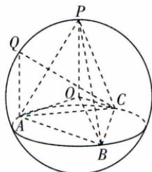
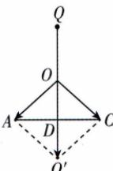
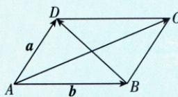
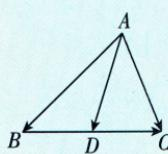

> [!faq]- 必刷题解析
> **【答案】** C
>
> **【解析】**
> 由题意,如图①所示,设点O为正四面体PABC的外接球球心,连接OA,OB,OC,OP.

图①
则 $OA = OB = OC = OP = \frac{\sqrt{6}}{4} \times \sqrt{2} = \frac{\sqrt{3}}{2}$ , 且 $\overrightarrow{QA} \cdot \overrightarrow{QC} = (\overrightarrow{QO} + \overrightarrow{OA}) \cdot (\overrightarrow{QO} + \overrightarrow{OC}) = |\overrightarrow{QO}|^2 + \overrightarrow{QO} \cdot (\overrightarrow{OA} + \overrightarrow{OC}) + \overrightarrow{OA} \cdot \overrightarrow{OC} = \left(\frac{\sqrt{3}}{2}\right)^2 + \overrightarrow{QO} \cdot (\overrightarrow{OA} + \overrightarrow{OC}) + |\overrightarrow{OA}| |\overrightarrow{OC}| \cdot \cos \angle AOC = \frac{3}{4} + \overrightarrow{QO} \cdot (\overrightarrow{OA} + \overrightarrow{OC}) + |\overrightarrow{OA}| |\overrightarrow{OC}| \frac{OA^2 + OC^2 - AC^2}{2 |OA| \cdot |OC|} = \frac{3}{4} + \overrightarrow{QO} \cdot (\overrightarrow{OA} + \overrightarrow{OC}) + \frac{OA^2 + OC^2 - AC^2}{2} = \frac{3}{4} + \overrightarrow{QO} \cdot (\overrightarrow{OA} + \overrightarrow{OC}) + (\overrightarrow{OA} + \overrightarrow{OC}) + \left(\frac{\sqrt{3}}{2}\right)^2 + \left(\frac{\sqrt{3}}{2}\right)^2 - (\sqrt{2})^2 = \frac{1}{2} + \overrightarrow{QO} \cdot$
$$
(\overrightarrow {O A} + \overrightarrow {O C})
$$
当 $\overrightarrow{QO}$ 与 $\overrightarrow{OA} +\overrightarrow{OC}$ 同向时， $\overrightarrow{QA}\cdot \overrightarrow{QC}$ 的值最大点悟：两向量同向时夹角的余弦值为1设 $\overrightarrow{OA} +\overrightarrow{OC} = \overrightarrow{OO^{\prime}}$ ，设 $AC$ 的中点为 $D$ ，则 $OO^{\prime}$ 过点 $D$ ，如图②所示. $AD =$ $CD = \frac{1}{2} AC = \frac{\sqrt{2}}{2},\therefore OD =$

图②
$\sqrt{AO^{2}-AD^{2}}=\sqrt{\left(\frac{\sqrt{3}}{2}\right)^{2}-\left(\frac{\sqrt{2}}{2}\right)^{2}}=\frac{1}{2},$ $OO' = 2OD = 1$ , 故 $(\overrightarrow{QA} \cdot \overrightarrow{QC})_{\max} = \frac{1}{2} + \frac{\sqrt{3}}{2} \times 1 \times \cos 0^{\circ} = \frac{\sqrt{3} + 1}{2}$ ，
>
> 故选 **C**.
>
> ---
> **🔀 多种解法**
> 取 $AC$ 的中点 $M$ , 正四面体 $PABC$ 的外接球球心为 $O$ , 连接 $OA, OM$ (图略), 则 $\overrightarrow{QA} \cdot \overrightarrow{QC} = (\overrightarrow{QM} + \overrightarrow{MA}) \cdot (\overrightarrow{QM} + \overrightarrow{MC}) = \left(\overrightarrow{QM} - \frac{1}{2}\overrightarrow{AC}\right) \cdot \left(\overrightarrow{QM} + \frac{1}{2}\overrightarrow{AC}\right) = \overrightarrow{QM}^2 - \frac{1}{4}\overrightarrow{AC}^2$ , 因为 $AC$ 长度是定值, 故当 $|\overrightarrow{QM}|$ 最大时, 数量积最大. 显然, 当 $Q$ 在 $MO$ 的延长线与球面的交点处时, $|\overrightarrow{QM}|$ 最大. 因为 $OA = \frac{\sqrt{6}}{4} \times \sqrt{2} = \frac{\sqrt{3}}{2}$ , 所以 $OM = \sqrt{OA^2 - \left(\frac{1}{2}AC\right)^2} = \frac{1}{2}$ , 此时 $QM = OM + \frac{\sqrt{3}}{2} = \frac{1 + \sqrt{3}}{2}$ , 则 $(\overrightarrow{QA} \cdot \overrightarrow{QC})_{\max} = \frac{\sqrt{3} + 1}{2}$ . 二级结论 棱长为 $a$ 的正四面体, 其高为 $\frac{\sqrt{6}}{3} a$ , 外接球半径 $R = \frac{\sqrt{6}}{4} a$ , 内切球半径 $r = \frac{\sqrt{6}}{12} a$ .
>
> ---
> **📚 二级结论**
> 极化恒等式
(1)根据向量的数量积运算,对任意向量 a, b, 有 $a \cdot b = \frac{1}{4} \left[ (a + b)^{2} - (a - b)^{2} \right]$ , 则在平行四边形 ABCD 中, $\overrightarrow{AB} \cdot \overrightarrow{AD} = \frac{1}{4} (\overrightarrow{AC^{2}} - \overrightarrow{BD^{2}})$ .

(2)在三角形 $ABC$ 中，若 $D$ 为 $BC$ 边的中点，则 $\overrightarrow{AB} \cdot \overrightarrow{AC} = \frac{1}{4}[(2\overrightarrow{AD})^2 - \overrightarrow{BC}^2]$ .

对应题目：[Q070000003916](../Q070000003916.md)

> 来源：2026版 必刷题 数学选择性必修第一册RJA
