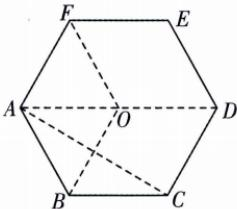

> [!faq]- 必刷题解析
> **【解析】**
> 【解】(1)设正六边形 $ABCDEF$ 的中心为 $O$ , 连接 $OB, OF, AD, AC$ ,

1.4 空间向量的应用
又 $\frac{2}{1}\neq\frac{1}{1}\neq\frac{-2}{1}$ ，故直线 $l_{1},l_{2}$ 不平行，所以两条直线相交或异面。故选D.
→地坑：空间中两条直线不平行时，不要漏掉异面的情况

对应题目：[Q070000003922](../Q070000003922.md)

> 来源：2026版 必刷题 数学选择性必修第一册RJA
