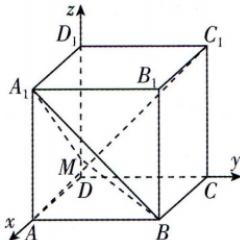

> [!faq]- 2026版 必刷题 数学选择性必修第一册RJA
> **【答案】** A
>
> **【解析】**
> 如图, 以 D 为坐标原点, 分别以 DA, DC, $DD_{1}$ 所在直线为 x, y, z 轴, 建立空间直角坐标系,
> 
> 设正方体的棱长为 $1, M(0,0,t), 0 \leqslant t \leqslant 1$ ，则 $A(1,0,0), C_1(0,1,1), B(1,1,0), A_1(1,0,1)$ ， $\therefore \overrightarrow{AC_1} = (-1,1,1), \overrightarrow{BM} = (-1,-1,t)$ 。\$\because\$ 直线 $AC_1 \perp$ 平面 $A_1BM, BM \subset$ 平面 $A_1BM, \therefore AC_1 \perp BM, \therefore \overrightarrow{AC_1} \cdot \overrightarrow{BM} = 0$ ，即 $-1 \times (-1) + 1 \times (-1) + 1 \times t = 0$ ，解得 $t = 0$ ，此时点 $M$ 与点 $D$ 重合。又 \$\xrightarrow{\text{敲黑板}}\$ 由一组线线垂直确定点 $M$ 的位置后，需检验是否符合题意 $\overrightarrow{A_1B} = (0,1,-1), \overrightarrow{AC_1} \cdot \overrightarrow{A_1B} = 0,$ \$\therefore AC\_1 \perp A\_1B\$, 又 $BM \cap A_1B = B, BM,$ $A_1B \subset$ 平面 $A_1BM, \therefore AC_1 \perp$ 平面 $A_1BM$ , 符合题意。
>
> 故选 **A**.
