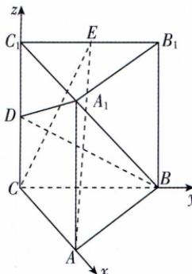

> [!faq]- 2026版 必刷题 数学选择性必修第一册RJA
> **【解析】**
> 【证明】如图，以 C 为坐标原点，CA, CB, $CC_{1}$ 所在直线分别为 x, y, z 轴，建立空间直角坐标系，
> 则 $C(0,0,0)$ , $A(2,0,0)$ , $B(0,2,0)$ , $A_{1}(2,0,2)$ , $E(0,1,2)$ , $D(0,0,1)$ ,
> 所以 $\overrightarrow{CA}=(2,0,0)$ , $\overrightarrow{AE}=(-2,1,2)$ , $\overrightarrow{DA_{1}}=(2,0,1)$ , $\overrightarrow{DB}=(0,2,-1)$ .
> 设平面 $A_{1}BD$ 的法向量为 $m=(x,y,z)$ ，则 $\left\{\begin{aligned}\boldsymbol{m}\cdot\overrightarrow{DA_{1}}=0,\\ \boldsymbol{m}\cdot\overrightarrow{DB}=0,\end{aligned}\right.$ 即 $\left\{\begin{aligned}2x+z=0,\\ 2y-z=0,\end{aligned}\right.$ 令 x=-1，可得平面 $A_{1}BD$ 的一个法向量 $m=(-1,1,2)$ .
> 设平面 ACE 的法向量为 $n=(a,b,c)$ ，则 $\left\{\begin{aligned}\boldsymbol{n}\cdot\overrightarrow{CA}=0,\\ \boldsymbol{n}\cdot\overrightarrow{AE}=0,\end{aligned}\right.$ 即 $\left\{\begin{aligned}2a=0,\\ -2a+b+2c=0,\end{aligned}\right.$ 令 b=2，可得平面 ACE 的一个法向量 $n=(0,2,-1)$ .
> 因为 $m \cdot n = -1 \times 0 + 1 \times 2 + 2 \times (-1) = 0$ ，所以 $m \perp n$ 所以平面 $ACE \perp$ 平面 $A_{1}BD$ .
> 
