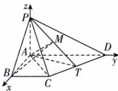

> [!faq]- 2026版 必刷题 数学选择性必修第一册RJA
> **【解析】**
> (1)【证明】由 $PA \perp$ 平面 ABCD, PB 与底面 ABCD 所成角为 $45^{\circ}$ , 可知 $\angle PBA = 45^{\circ}$ , 所以 PA = AB.
> 又 $PA = BC = 2$ ，所以 $AB = 2.$ 因为四边形ABCD是梯形， $AD\perp$ $AB,BC / / AD$ ，所以 $AC = 2\sqrt{2}.$ 由 $AD = 4,BC = 2$ ，可得 $CD = 2\sqrt{2}$ 则 $CD^2 +AC^2 = AD^2$ ，所以 $CD\bot AC.$ 由 $PA\bot$ 平面ABCD， $CD\subset$ 平面ABCD，可得 $PA\bot CD.$ 又 $PA\cap AC = A,PA,AC\subset$ 平面PAC，所以 $CD\bot$ 平面PAC.又 $CD\subset$ 平面PCD，所以平面PAC⊥平面PCD.(2)【解】根据题意可知 $AB,AD,AP$ 两两垂直，所以以 $A$ 为坐标原点， $AB,$ $AD,AP$ 所在直线分别为 $x,y,z$ 轴建立如图所示的空间直角坐标系，则 $A(0,0,0),P(0,0,2),B(2,0,0),$ $C(2,2,0),D(0,4,0)$ ，连接AT，由点 $T$ 是线段 $CD$ 上的动点，可设 $\overrightarrow{AT} = \lambda \overrightarrow{AC} + (1 - \lambda)\overrightarrow{AD},\lambda \in [0,1]$ 即 $\overrightarrow{AT} = \lambda (2,2,0) + (1 - \lambda)(0,4,0) =$ $(2\lambda ,4 - 2\lambda ,0)$ ，所以 $T(2\lambda ,4 - 2\lambda ,$ 0).因此 $\overrightarrow{PT} = (2\lambda ,4 - 2\lambda , - 2).$ 设 $\overrightarrow{PM} = \mu \overrightarrow{PT} = (2\lambda \mu ,4\mu -2\lambda \mu , - 2\mu),$ $\mu \in [0,1]$ ，由 $P(0,0,2)$ 可得 $M(2\lambda \mu ,4\mu -2\lambda \mu ,2 - 2\mu)$ 所以 $\overrightarrow{AM} = (2\lambda \mu ,4\mu -2\lambda \mu ,2 - 2\mu).$ 又 $\overrightarrow{AB} = (2,0,0)$ 若 $PT\bot$ 平面ABM，则 $\left\{ \begin{array}{l}\overrightarrow{AB}\cdot \overrightarrow{PT} = 4\lambda = 0,\\ \overrightarrow{AM}\cdot \overrightarrow{PT} = 4\lambda^2\mu +\mu (4 - 2\lambda)^2 -2(2 - 2\mu) = 0,\end{array} \right.$ 解得 $\lambda = 0,\mu = \frac{1}{5}$ ，符合题意，可得 $\frac{PM}{PT} = \frac{1}{5},$ 即存在点 $M$ ，当 $\frac{PM}{PT} = \frac{1}{5}$ 时，有 $PT\bot$ 平面ABM.
> 
