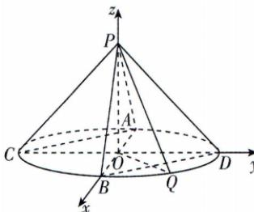

> [!faq]- 2026版 必刷题 数学选择性必修第一册RJA
> **【解析】**
> (1)【证明】因为 $PO \perp$ 平面AOC, AC⊂平面AOC, 所以 $PO \perp AC$ , 当 $\angle QOB = \frac{\pi}{4}$ 时, $\angle QOD = \frac{\pi}{4}$ , 如图, 连接BD, 则 $BD \perp OQ$ . 因为 $AB \perp CD, OA = OB, OC = OD$ , 所以 $\triangle AOC \cong \triangle BOD$ , 则 $\angle OAC = \angle OBD$ , 故 $BD // AC$ , 所以 $AC \perp OQ$ . 又因为 $PO \cap QO = O, PO, QO \subset$ 平面POQ, 所以 $AC \perp$ 平面POQ, 又因为 $PQ \subset$ 平面POQ, 所以 $PQ \perp AC$ . (2)【解】以O为坐标原点, 分别以 $\overrightarrow{OB}, \overrightarrow{OD}, \overrightarrow{OP}$ 的方向为x,y,z轴的正方向, 建立如图所示的空间直角坐标系,
> 
> 设 $\angle QOB = \theta (\theta \in (0,\pi))$ ，则 $A(-1,0,0),B(1,0,0),C(0, - 1,0),P(0,0,1),Q(\cos \theta ,\sin \theta ,0)$ 心：将坐标表示为三角形式，运用三角函数的值域求得角的范围所以 $\overrightarrow{PA} = (-1,0, - 1),\overrightarrow{PC} = (0, - 1,-1).$ 设平面PAC的法向量为 $\pmb {m} = (x,y,z)$ 则 $\left\{ \begin{array}{l}\pmb {m}\cdot \overrightarrow{PA} = 0,\\ \pmb {m}\cdot \overrightarrow{PC} = 0, \end{array} \right.$ 即 $\left\{ \begin{array}{l} - x - z = 0,\\ -y - z = 0, \end{array} \right.$ 取 $x = 1,$ 则 $z = -1,y = 1$ ，所以 $\pmb {m} = (1,1, - 1).$ 设 $\overrightarrow{PT} = t\overrightarrow{PQ}(t\in (0,1))$ ，因为 $\overrightarrow{PQ} =$ （cosθ，sinθ，-1）， $\overrightarrow{BP} = (-1,0,1)$ ，所以 $\overrightarrow{PT} = (t\cos \theta ,t\sin \theta , - t)$ ，所以 $\overrightarrow{BT} =$ $\overrightarrow{BP} +\overrightarrow{PT} = (t\cos \theta -1,t\sin \theta ,1 - t).$ 因为 $BT / /$ 平面PAC，所以 $\overrightarrow{BT}\cdot \pmb {m}=$ $t\cos \theta -1 + t\sin \theta +t - 1 = 0,$ 即cosθ+sinθ= $\frac{2}{t} -1,t\in (0,1)$ 所以sin（θ+π/4）=√2/t-√2>√2/2，又θ∈(0,π)，所以θ∈(0,π/2).即∠QOB的取值范围为（0,π/2）.
