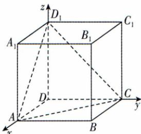

> [!faq]- 必刷题解析
> **【答案】** B
>
> **【解析】**
> 由题意得， $\overrightarrow{DE}=x\overrightarrow{DA}+y\overrightarrow{DC}+(1-x-y)\overrightarrow{DD_{1}}$ ∴ $\overrightarrow{DE}-\overrightarrow{DD_{1}}=x(\overrightarrow{DA}-\overrightarrow{DD_{1}})+y(\overrightarrow{DC}-\overrightarrow{DD_{1}})$ ，即 $\overrightarrow{D_{1}E}=x\overrightarrow{D_{1}A}+y\overrightarrow{D_{1}C}$ ，
由共面向量定理得， $D_{1}, E, A, C$ 四点共面，即点 E 在平面 $D_{1}AC$ 上，
则 $|\overrightarrow{DE}|$ 的最小值为点 D 到平面 $D_{1}AC$ 的距离。以 D 为原点建立如图所示的空间直角坐标系，
则 $D(0,0,0), A(2,0,0), C(0,2,0), D_{1}(0,0,2), \therefore \overrightarrow{AC}=(-2,2,0), \overrightarrow{AD_{1}}=(-2,0,2), \overrightarrow{DA}=(2,0,0)$ ，设平面 $D_{1}AC$ 的法向量为 $\boldsymbol{n}=(x,y,z)$ ，
则 $\left\{\begin{aligned}\overrightarrow{AC}\cdot n=0,\\ \overrightarrow{AD_{1}}\cdot n=0,\end{aligned}\right.$ 即 $\left\{\begin{aligned}-2x+2y=0,\\ -2x+2z=0,\end{aligned}\right.$ 令 x=1，则 $\boldsymbol{n}=(1,1,1)$ ，则点 D 到平面 $D_{1}AC$ 的距离 $d=\frac{|\overrightarrow{DA}\cdot\boldsymbol{n}|}{|\boldsymbol{n}|}=\frac{2}{\sqrt{3}}=\frac{2\sqrt{3}}{3}$ ，
即 $|\overrightarrow{DE}|$ 的最小值是 $\frac{2\sqrt{3}}{3}$ . 故选 B.

对应题目：[Q070000003952](../Q070000003952.md)

> 来源：2026版 必刷题 数学选择性必修第一册RJA
