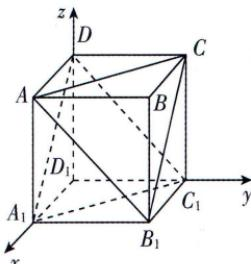

> [!faq]- 2026版 必刷题 数学选择性必修第一册RJA
> **【答案】** B
>
> **【解析】**
> 建立如图所示的空间直角坐标系 $D_{1}xyz$ ，则 $A_{1}(1,0,0)$ ， $C_{1}(0,1,0)$ ， $D(0,0,1)$ ， $A(1,0,1)$ ，所以 $\overrightarrow{DA_{1}}=(1,0,-1)$ ， $\overrightarrow{DC_{1}}=(0,1,-1)$ ， $\overrightarrow{AD}=(-1,0,0)$ 。
> 设平面 $A_{1}C_{1}D$ 的法向量为 $m=(x,y,1)$ ，则 $\left\{\begin{aligned}\boldsymbol{m}\cdot\overrightarrow{DA_{1}}=x-1=0,\\ \boldsymbol{m}\cdot\overrightarrow{DC_{1}}=y-1=0,\end{aligned}\right.$
> 解得 $\left\{\begin{aligned}x&=1,\\ y&=1,\end{aligned}\right.$ 故 $m=(1,1,1)$ .
> 显然平面 $AB_{1}C \parallel$ 平面 $A_{1}C_{1}D$ ，所以平面 $AB_{1}C$ 与平面 $A_{1}C_{1}D$ 之间的距离 $d=\frac{|\overrightarrow{AD}\cdot\boldsymbol{m}|}{|\boldsymbol{m}|}=\frac{1}{\sqrt{3}}=\frac{\sqrt{3}}{3}.$ 故选 B.
> 
