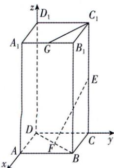

> [!faq]- 必刷题解析
> **【答案】** D
>
> **【解析】**
> 如图，以 $D$ 为坐标原点， $DA, DC, DD_{1}$ 所在直线分别为 $x, y, z$ 轴建立空间直角坐标系，设 $AA_{1} = 2, AB = 1$ ，则 $C_{1}(0, 1, 2)$ ， $G\left(1, \frac{1}{2}, 2\right), E(0, 1, 1), F\left(\frac{1}{2}, \frac{1}{2}, 0\right)$ ，则 $\overrightarrow{C_1G} = \left(1, -\frac{1}{2}, 0\right), \overrightarrow{EF} = \left(\frac{1}{2}, -\frac{1}{2}, -1\right)$ ，故 $|\cos \langle \overrightarrow{C_1G}, \overrightarrow{EF} \rangle| = \frac{|\overrightarrow{C_1G} \cdot \overrightarrow{EF}|}{|\overrightarrow{C_1G}| |\overrightarrow{EF}|} = \frac{\left|(1, -\frac{1}{2}, 0) \cdot \left(\frac{1}{2}, -\frac{1}{2}, -1\right)\right|}{\sqrt{1 + \frac{1}{4} + 0} \times \sqrt{\frac{1}{4} + \frac{1}{4} + 1}} =$
$\frac{\frac{3}{4}}{\frac{\sqrt{5}}{2}\times\frac{\sqrt{6}}{2}}=\frac{\sqrt{30}}{10}$ ，故直线 $C_{1}G$ 与EF所成角的余弦值为 $\frac{\sqrt{30}}{10}$ 。
>
> 故选 **D**.
>
> ---
> **⚠️ 避坑**
> 异面直线所成角的范围为 $\left(0, \frac{\pi}{2}\right]$ , 其余弦值非负

>
> ---
> **🔗 链接教材**
> 本题是教材第38页练习第1题的变式,考查求异面直线所成的角,主要有两种方法:一是向量法,根据几何体的特殊性质建立空间直角坐标系后,分别求出两直线的方向向量,再利用空间向量夹角的余弦公式求解;二是传统法,利用平行四边形、三角形中位线等方法找出两直线所成的角,再利用平面几何性质求解.

对应题目：[Q070000003964](../Q070000003964.md)

> 来源：2026版 必刷题 数学选择性必修第一册RJA
