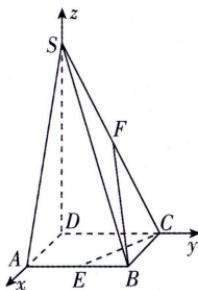

> [!faq]- 必刷题解析
> **【答案】** C
>
> **【解析】**
> 以 D 为坐标原点, 建立如图所示的空间直角坐标系 Dxyz. 设 SD = t (t > 0), 则 B(2, 2, 0), C(0, 2, 0), S(0, 0, t), E(2, 1, 0), F(0, 1, $\frac{t}{2}$ ), 所以 $\overrightarrow{EC} = (-2, 1, 0)$ , $\overrightarrow{BF} = (-2, -1, \frac{t}{2})$ . 因为直线 EC 与 BF 所成角的余弦值为 $\frac{\sqrt{5}}{5}$ , 所以 $|\cos\langle\overrightarrow{EC}, \overrightarrow{BF}\rangle| = \frac{|\overrightarrow{EC} \cdot \overrightarrow{BF}|}{|\overrightarrow{EC}| |\overrightarrow{BF}|} = \frac{|4-1+0|}{\sqrt{4+1} \times \sqrt{4+1 + \frac{t^{2}}{4}}} = \frac{\sqrt{5}}{5}$ , 解得 t = 4 (负值舍去), 即 SD = 4. 故选 C.

对应题目：[Q070000003965](../Q070000003965.md)

> 来源：2026版 必刷题 数学选择性必修第一册RJA
